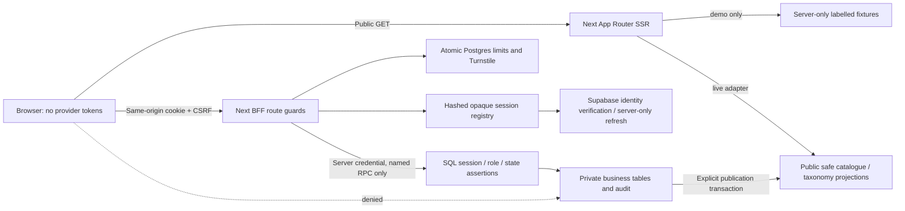
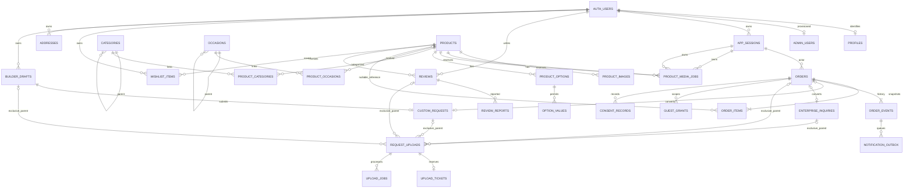

# Architecture and implemented boundaries

Solid implementation paths exist in code; live BFF credentials/provider flows remain unverified. Demo browsing reads only ten in-process fixtures, server-side. Live catalogue SQL bounds/paginates on the server. Public projection responses contain explicit safe keys, never base session/contact/moderation records. Ordinary anon/authenticated tokens have neither private schema usage nor private table DML nor business RPC execution. All private tables have RLS with no browser policies, deliberately deny-by-default. Service role bypasses RLS; SQL registry/role assertions enforce its application writes instead.

PKCE state/verifier is encrypted in a short-lived HttpOnly cookie. Access/refresh tokens are encrypted with jose in the private registry, never browser-readable. A no-store session endpoint supplies a separate CSRF value and, when configured, a random pre-guest cookie. Guest registration uses a unique hash so concurrent retries reuse the actor. Refresh uses an expiring SQL lease and checked commit, not an in-process lock. Managed identity revocation, provider token lifetime, lease expiry races and real parallel refresh still need staging evidence.

Admin sessions start quarantined at aal1 and cannot pass SQL admin assertions. TOTP verification calls the installed SDK, verifies the updated managed identity/assurance, rotates the opaque cookie and records MFA time. The database rechecks current active membership for every business action. Hidden route knowledge is not authorization. No customer route can set a role or assurance boolean.

The public projection publication function includes active taxonomy ancestor checks, sanitized/published image references and an explicit JSON field list. Products without publishable media/categories do not enter the public projection. Previously downloaded image bytes cannot be recalled; subsequent proxy reads are denied after hide/unpublish. The implemented product-media lifecycle reserves a session-bound ticket under SQL quotas, claims it once, quarantines privately, fully decodes/re-encodes, attaches privately, then requires explicit image/product publication. Private sanitized previews require current admin checks. Public image proxy requests recheck the current publication and browse gate, never share-cache, and bypass the Next optimizer. Hosted Storage tests remain unexecuted.

## ERD (implemented tables, including disabled later-phase contracts)

Additional independent contracts: `site_settings`, `code_counters`, `idempotency_keys`, `sales_proof_items`, `status_sla_rules`, `jobs`, `audit_log`, and private `auth_attempts`, `rate_buckets` and `product_media_jobs`. Exact columns, CHECK/UNIQUE/FK constraints and all policies/grants are in the ordered migrations. A draft/request/upload contract is not an active product feature. No payment/shipment/tenant tables or external webhooks were activated.

Public objects are three safe publication tables: `memocious_catalogue_products`, `memocious_taxonomy_items`, and `memocious_public_config`. They have RLS plus SELECT-only browser grants and no customer identity fields. Public catalogue API/RPCs are separate from the server-only business RPCs.

## Cache/SEO

Nonce-bearing HTML is dynamic SSR/no-store. There is no ISR/session refresh mixture. Static media/font files are public by design. The service worker caches only offline HTML and icons, not normal page HTML or API responses. Preview HTML is noindex, robots excludes the preview, sitemap is empty. Production canonicals and truthful structured data await a genuine catalogue/origin. There are no fabricated review aggregates or purchase offers.

## Hosting and operator boundary

Next uses Netlify’s framework adapter and a separate bounded scheduled media cleanup function. No deployment is live. Public site settings are verified on Netlify; secret/provider bindings and runtime egress remain unresolved. Operator bootstrap is a separate trusted script, requires an existing verified identity and service key, and cannot be invoked through an application route. Managed39-migration history and37 privateRLS tables match generated types. Key rotation supports explicitly configured previous versions; local cryptographic tests do not certify a real session migration.

## Hosting and operator boundary

Next uses Netlify’s framework adapter and a separate bounded scheduled media cleanup function. No deployment is live. Public site settings are verified on Netlify; secret/provider bindings and runtime egress remain unresolved. Operator bootstrap is a separate trusted script, requires an existing verified identity and service key, and cannot be invoked through an application route. Managed39-migration history and37 privateRLS tables match generated types. Key rotation supports explicitly configured previous versions; local cryptographic tests do not certify a real session migration.
